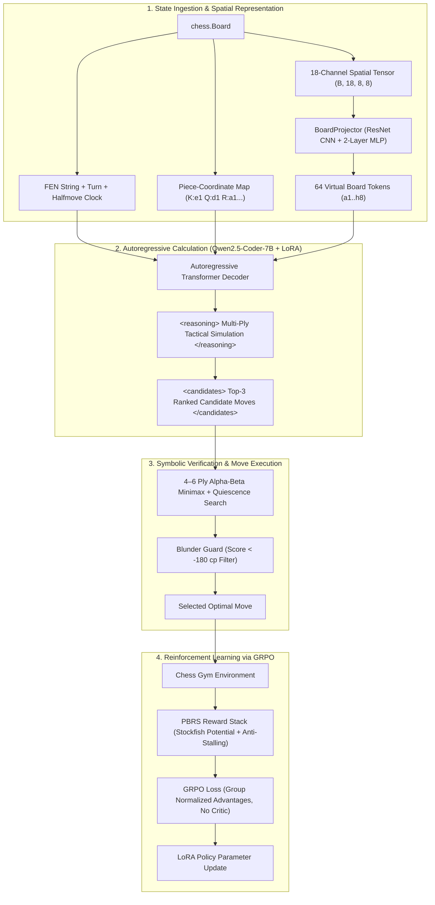

# Chimera: Neuro-Symbolic Chess RL with GRPO & Tactical Verification

**Chimera** is an efficient neuro-symbolic chess reasoning policy built upon `Qwen2.5-Coder-7B-Instruct`, Low-Rank Adaptation (LoRA), and Group Relative Policy Optimization (GRPO). It marries autoregressive language model calculation with a strict 4-to-6 ply alpha-beta minimax verifier, achieving grandmaster-level tactical safety without hardcoded opening books or external engine lookups at play time.

---

## 🏛️ Architectural Overview

Chimera operates across a 4-pillar neuro-symbolic pipeline designed to overcome the spatial blind spots of autoregressive language models while preserving fast, verifiable tactical reasoning.



---

## 🔑 Key Pillars

### 1. Spatial Grounding: Mitigating BPE Tokenizer Fragmentation
Standard Byte-Pair Encoding (BPE) tokenizers fragment standard FEN strings into arbitrary character clumps (`rnb`, `qk`, `bnr/pp`), making diagonal and rank/file geometric reasoning notoriously difficult for LLMs. Chimera addresses this through two complementary mechanisms:
- **Piece-Coordinate Map**: A structured textual coordinate mapping (`White: K:e1 Q:d1 R:a1...`, `Black: K:e8...`) that explicitly binds every piece to its algebraic square coordinate.
- **LLaVA-Style Soft-Prompt Board Projector (`BoardProjector`)**:
  - Encodes the board into an exact **18-channel spatial tensor** (12 piece planes, 4 castling rights, 1 en-passant plane, 1 side-to-move plane).
  - Processes the tensor through a 4-stage **spatial ResNet CNN** preserving the exact $8 \times 8$ grid resolution.
  - Projects the 64 square vectors through a 2-layer MLP directly into the LLM's token embedding space (`hidden_size = 3584`), prepending 64 virtual board tokens to `inputs_embeds`.

### 2. SFT Cold-Start Warmup with Multi-Ply Tactical CoT
Before reinforcement learning, the base model is warmed up on 1,200 curated Lichess tactical puzzles:
- Generates step-by-step tactical mental calculation in `<reasoning>` tags (identifying forcing checks, captures, undefended pieces, and opponent counter-replies).
- Outputs **3 ranked candidate moves** in structured XML (`<candidates>1. <move>...</move></candidates>`).
- Employs PyTorch Scaled Dot-Product Attention (SDPA), TF32 Tensor Core acceleration, and gradient accumulation.

### 3. Group Relative Policy Optimization (GRPO)
Unlike PPO, which requires maintaining an equally sized critic value model (doubling VRAM requirements), Chimera uses **GRPO**:
- **Rollout Sampling**: Samples a group of $G=12$ completions for each board state.
- **Group Advantage Normalization**: Computes advantages directly from the relative rewards within each group:
  $$A_i = \frac{R_i - \text{mean}(\{R_j\}_{j=1}^G)}{\text{std}(\{R_j\}_{j=1}^G) + \epsilon}$$
- **Dynamic Adapter Bypass**: Computes reference model log-probabilities by temporarily disabling LoRA adapters under `torch.inference_mode()`, completely eliminating the need for a separate 15 GB frozen reference model copy in VRAM.
- **Potential-Based Reward Shaping (PBRS)**: Stockfish evaluations are mapped into bounded potential values:
  $$\Phi(s) = \frac{2}{1 + 10^{-\text{cp}/400}} - 1 \in [-1, 1]$$
  guaranteeing policy invariance over circular trajectories: $F(s, a, s') = \gamma \Phi(s') - \Phi(s)$.
- **Stockfish Zobrist Cache**: Uses an EPD-keyed SQLite database to cache evaluation scores and avoid redundant engine subprocess invocations.

### 4. Neuro-Symbolic Tactical Verifier
During inference and match play, the candidate moves output by the model are vetted by a selective **4-to-6 ply alpha-beta minimax search**:
- **MVV-LVA Move Ordering**: Most Valuable Victim – Least Valuable Attacker prioritization accelerates alpha-beta cutoffs.
- **Quiescence Search**: Extends search by +2 plies for active tactical lines (captures and checks) to resolve the horizon effect.
- **Blunder Protection Guard**: If candidate 1 drops material below $-180\text{ cp}$ while candidate 2 is tactically safe, the verifier automatically overrides the proposal and executes the safe candidate.

---

## 📁 Repository Structure

```text
chimera/
├── config.yaml                     # Central configuration (hyperparameters, rewards, LoRA)
├── chess-rl-eval/
│   ├── config.yaml                 # Linked configuration file
│   ├── pyproject.toml              # Project dependencies and packaging metadata
│   ├── datasets/
│   │   ├── download_lichess_puzzles.py   # Zstandard streaming Lichess puzzle ingest
│   │   ├── pgn2fen_loader.py             # PGN game replay and half-move ply extraction
│   │   └── puzzles.jsonl                 # Curated stratified tactical dataset (1,200 puzzles)
│   ├── src/
│   │   ├── env/
│   │   │   ├── state_encoder.py          # Piece-coordinate spatial serialization
│   │   │   ├── cache.py                  # SQLite Zobrist/EPD Stockfish potential cache
│   │   │   └── chess_gym.py              # Gym environment with full PBRS reward stack
│   │   ├── models/
│   │   │   ├── sft_warmup.py             # Supervised fine-tuning cold-start with CoT
│   │   │   ├── grpo_trainer.py           # GRPO training loop with LoRA & dynamic bypass
│   │   │   ├── logit_masker.py           # Constrained decoding legal move trie masker
│   │   │   └── board_projector.py        # LLaVA-style ResNet board projector
│   │   ├── verifier/
│   │   │   └── tactical_verifier.py      # 4-6 ply alpha-beta minimax + quiescence search
│   │   └── evals/
│   │       ├── run_pgn2fen.py            # Tier 1 board reconstruction evaluation
│   │       ├── run_puzzles.py            # Tier 2 Pass@1 tactical puzzle solver evaluation
│   │       └── run_maia_match.py         # Tier 3 match play against Maia / Stockfish
│   ├── tests/
│   │   ├── test_pbrs_invariance.py       # PBRS mathematical invariant verification
│   │   └── test_board_projector.py       # Board projector & tensor encoding unit tests
│   └── scripts/
│       └── cloud_setup.sh                # Automated cloud GPU provisioning script
└── README.md
```

---

## 🚀 Quickstart

### 1. Environment Setup

```bash
# Clone the repository
git clone https://github.com/shrkk/chimera.git
cd chimera/chess-rl-eval

# Install system dependencies (Ubuntu/Debian)
apt-get update && apt-get install -y stockfish git tmux htop

# Install Python requirements
pip install -r requirements.txt peft transformers accelerate python-chess zstandard aiosqlite pytest
```

### 2. Verify Mathematical Invariants

Run the automated test suite verifying PBRS reward telescoping, advantage normalization, and the board projector:

```bash
pytest tests/ -v
```

### 3. Phase 1: SFT Cold-Start Warmup

Train the LoRA adapter on 1,200 multi-ply tactical CoT puzzle solutions:

```bash
python3 src/models/sft_warmup.py \
    --model-path Qwen/Qwen2.5-Coder-7B-Instruct \
    --output-dir checkpoints/sft_chess_7b \
    --puzzle-file datasets/puzzles.jsonl \
    --epochs 2 \
    --batch-size 4 \
    --gradient-checkpointing
```

### 4. Phase 2: Extended GRPO Training

Launch the 2,500-episode GRPO reinforcement learning run ($G=12$ completions per state):

```bash
PYTORCH_CUDA_ALLOC_CONF=expandable_segments:True python3 src/models/grpo_trainer.py --config config.yaml
```

### 5. Match Play Evaluation (Tier 3)

Evaluate the trained policy against the Maia-1300 human-like neural network or a handicapped Stockfish engine:

```bash
python3 src/evals/run_maia_match.py \
    --checkpoint checkpoints/grpo_chess_step_500 \
    --opponent maia-1300 \
    --games 20
```

---

## 📊 Evaluation Tiers

Chimera evaluates chess reasoning capability across three distinct tiers:
1. **Tier 1 (State Tracking — `run_pgn2fen.py`)**: Tests whether the LLM can reconstruct the exact FEN board string from a sequence of UCI moves across plies 10, 20, 30, and 40.
2. **Tier 2 (Tactical Puzzles — `run_puzzles.py`)**: Tests Pass@1 tactical accuracy across Elo bands (800–1100, 1100–1400, 1400–1700) using the State Encoder and Tactical Verifier.
3. **Tier 3 (Engine Match Play — `run_maia_match.py`)**: Measures Legal Move Compliance Rate (LMCR), win/loss/draw rates, and Bayes-Elo differential in live games with complete PGN recording.

---

## 📜 License

MIT License. See [LICENSE](LICENSE) for details.
